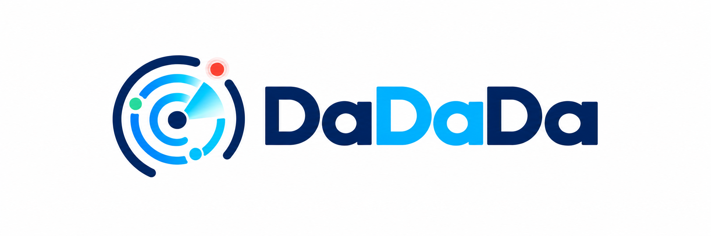

<p align="center">
  
</p>

# DaDaDa

What's breaking now?

Developer が使っている Cloud / SaaS / Runtime / OSS の **現在状態・発生中の障害・Security Advisory** を 1 画面で確認する Developer Status / Security Radar。
自分で監視はせず、公開 Status Page / Security Feed を **Collect → Normalize → Browse** する。

## 主な機能

- ホーム (`/`) は発生中の障害を先頭に表示し、セキュリティ・公式告知・悪用確認済み情報をタブで切り替えられます。サービスの稼働状況は右側に並び、小さい画面では縦に並びます。ページ全体をスクロールする構成です。
- 情報一覧は最初の4件を表示し、「さらに表示」で12件ずつ追加できます。タブの件数と一覧の件数は同じ絞り込み条件で集計します。公式告知には各サービスの最新1件と、深刻度の記載がないセキュリティ告知を表示します。
- サービス名から詳細画面 (`/d/:providerId`) に移動し、現在状態・発生中の障害・最近の履歴・公式告知・セキュリティ情報を確認できます。
- セキュリティ情報は言語と重要度で絞り込めます。重要度のない公式告知と、CISA KEV（悪用が確認された脆弱性）はそれぞれ別枠で表示します。
- ホームと詳細画面は60秒ごとにAPIを再取得します。上流からの収集はStatusが5分ごと、Securityが30分ごとです。取得済みの稼働状態が30分を超えて古くなると「不明」にします（RSSなどの「未判定」は維持します）。
- 日本語・英語の切り替えと、OSの設定に合わせたライト・ダーク表示に対応しています。

## Stack

- Cloudflare Workers + Hono (API / Cron)
- Cloudflare D1
- React + Vite (`@cloudflare/vite-plugin` で Worker と SPA を 1 プロジェクトに)
- Vanilla CSS

## Source

| 種別 | Source | 取得方法 |
| --- | --- | --- |
| Status | Cloudflare / GitHub / Vercel / Netlify | Statuspage API (`StatuspageAdapter`) |
| Status | AWS | 公式 RSS（公開告知のみ。稼働状態は未判定） |
| Status | Azure | 公式 RSS（公開告知のみ。稼働状態は未判定） |
| Status | さくらインターネット | 公式 RSS（障害・メンテナンスの告知のみ。稼働状態は未判定） |
| Status | Supabase | incident.io の Statuspage 互換 API（未解決の障害の影響度も状態に反映） |
| Status | Railway | 公式ステータス JSON (`status.railway.com/api/status`) |
| Status | Google Cloud | `status.cloud.google.com/incidents.json` |
| Security | PHP | php.net Atom (security release のみ) |
| Security | Node.js | Vulnerability RSS |
| Security | GitHub Advisory | REST API（全体の reviewed / Critical） |
| Security | Go / Java / Rust / C# (.NET) のライブラリ | GitHub Advisory を `go` / `maven` / `rust` / `nuget` 別に High / Critical 収集（4 Source） |
| Security | Go 標準ライブラリ・toolchain | Go 公式 Vulnerability Database（OSV JSON） |
| Security | Java SE / GraalVM | Oracle 公式 Security Alerts RSS と Java SE Risk Matrix |
| Security | Rust / Cargo / rustup | Rust 公式ブログ Atom のセキュリティ告知 |
| Security | .NET / ASP.NET Core | Microsoft 公式リポジトリの Security Advisory API（2 Source） |
| Security | CISA KEV | JSON feed (直近 30 日の追加分) |
| Security | JPCERT/CC | 公式 RSS 1.0（注意喚起・緊急報告と Weekly Report） |

## ステータスと公式告知の扱い

### Supabase / Railway

Supabase は公式ステータスサイトの Statuspage 互換 API から、状態と障害履歴を5分間隔で取得します。集約状態が正常でも未解決の障害がある場合は、上流の影響度もカードの状態に反映します。認証キーは不要です。

Railway は公式ステータスサイトの公開 JSON を5分間隔で取得します。公式の影響度から状態を集約し、発生中の障害と復旧履歴を共通画面に表示します。`TRIAGE`（公式表示: Notice）は告知として扱い、障害件数に含めません。Noticeのみの場合は稼働状態を「未判定」にします。予定メンテナンスは告知、実施中はメンテナンスとして扱い、予定終了日時から復旧を推測しません。認証キーは不要ですが、専用JSON形式の変更時には取得処理の更新が必要です。

### AWS / Azure

AWS は [公式の全サービス RSS](https://status.aws.amazon.com/rss/all.rss) を5分間隔で収集し、Services と共通の「Incidents & notices」に表示します。ホームは各社の最新1件、詳細画面は最新30件です。GUID のサービスコード・リージョンを読み取れる場合は併記し、識別子と元データを保持します。RSS の文言や記事の消失から障害の発生中・復旧を推測せず、稼働状態は「未判定」、記事は `status=notice` として扱います。アカウント固有のイベントは対象外です。

AWS 公式は RSS の形式変更・網羅性の制約を説明し、プログラム連携には [EventBridge](https://docs.aws.amazon.com/health/latest/ug/cloudwatch-events-health.html) を推奨しています。将来の対応は [Issue #3](https://github.com/NAGA-29/DaDaDa/issues/3) で管理します。

Azure は [公式 RSS](https://azure.status.microsoft/en-us/status/feed/) を認証なしで5分間隔で収集し、他のクラウドと同じ Services と共通の告知一覧に表示します。ホームは最新1件、詳細画面は最新30件です。GUID・記事URLのクエリ・元データを保持し、同じ告知の再取得は上書きします。記事は `status=notice`、稼働状態は「未判定」とし、記事が0件でも正常稼働や復旧とは判断しません。[公開ステータスの対象](https://learn.microsoft.com/en-us/azure/service-health/azure-status-overview)は広範囲の障害などに限られ、サブスクリプション固有の障害・計画メンテナンスを取得する Azure Service Health 連携は含みません。

### さくらインターネット

Services に「さくらインターネット」を表示し、[公式の障害・メンテナンス RSS](https://www.sakura.ad.jp/rss/mainte.rdf) を5分間隔の Status 収集で取得します。クラウド・VPS・レンタルサーバ・専用サーバなどの告知が混在します。

RSS だけでは発生中・復旧済み・実施中の状態を確定できないため、状態は「未判定」（API: `unverified`）、記事は `kind=service` / `status=notice` として保存します。発生中のインシデント数や解決済み履歴には含めません。ホームでは他社と共通の「Incidents & notices」一覧に各サービスの最新告知1件を表示し、サービス名から詳細画面へ進むと最新30件の公式告知を確認できます。対象サービス・設備・実施日時・復旧状況は公式リンクから確認してください。

RSS から項目が消えても、復旧したとは判断しません。元データと記事 URL のクエリ ID を保持し、同じ告知の再取得は上書きします。

## セキュリティアラートの表示・収集範囲

- JPCERT/CC は通常版の [公式RSS](https://www.jpcert.or.jp/rss/jpcert.rdf) を30分間隔で収集します。フィードに掲載された注意喚起・緊急報告と Weekly Report の各項目が対象です。重要度・言語を推測せず、全言語表示時の「Official notices」に表示します。リンクのフラグメントを保持して週報の各項目を区別し、同じURLの更新は上書きします。RSSの日時は更新時にも変わるため、初回公開日時とは限りません。本文の追加取得・過去全件の同期・統合版のお知らせやJVN新着は対象外です。
- 言語フィルターで Go / Java / Rust / C# (.NET) と既存の JavaScript・PHP・Python を選べます。初期表示は Critical、High または High + Critical に切り替えられます。C++ の専用収集は追加していません。
- Go / Java / Rust / C# (.NET) は専用SourceでHigh / Criticalを収集します。JavaScript・PHP・Pythonのライブラリ情報は全体向けGitHub Advisory SourceのCriticalが対象で、Highの専用収集はありません。全体向けSourceは公開日時順の最新50件を取得します。
- PHP フィルターは PHP 本体（`php`）と Composer ライブラリ（`composer`）の両方を対象にします。
- 上流が重要度を提供しない公式告知は、重要度を推測せず「Official notices」に別表示します。言語フィルターはこの欄にも適用します。KEV は言語別情報がないため全言語共通の別枠です。
- CVE / GHSA が一致する情報は集約して表示し、複数言語にまたがる情報は各言語のフィルターで見つけられます。元のデータは取得元ごとに保存します。
- Go / Java / Rust / C# (.NET) のライブラリは各言語・各重要度について更新日時順に最大200件を毎回確認します。過去全件の同期ではありません。1 Source の取得失敗はほかの Source に波及させません。
- トップ画面は各言語の High / Critical / 重要度未設定それぞれ最大30件と全体の最新30件に、直近72時間のセキュリティ情報（最大100件、KEVを除く）を加えて重複をまとめます。件数が多い言語によって他言語が一覧から押し出されるのを防ぎます。KEVは直近30日の最大20件を別表示します。
- 取得した取り下げ済みAdvisoryは保存済みデータを更新し、一覧から除外します。
- Go 本体は標準ライブラリ・toolchain の更新順12件、Rust は公式 Atom に残っている告知、Java は過去120日内の最新4告知（Java SE 部分のみ）、.NET / ASP.NET Core は各公式リポジトリの最新100件が対象です。Java は Oracle Java SE / GraalVM の範囲で、全 JDK ベンダーを網羅するものではありません。
- GitHub API の呼び出しが増えるため、`GITHUB_TOKEN` の設定を推奨します。未設定でも取得できますが、公開 API のレート制限に達した Source は収集結果にエラーを返します。

取得元仕様: [GitHub Advisory API](https://docs.github.com/en/rest/security-advisories/global-advisories)、[Go 公式 DB](https://go.dev/doc/security/vuln/database)、[Rust の告知方針](https://rust-lang.org/security)、[Oracle Security Alerts](https://www.oracle.com/security-alerts/)、[.NET 公式告知](https://github.com/dotnet/runtime/security/advisories)。

## 開発

Node.js 22（CIと同じバージョン）と pnpm 12.14.0 を使用します。

```bash
pnpm install
cp wrangler.sample.jsonc wrangler.jsonc # 環境固有の設定を手元に作成
cp .dev.vars.example .dev.vars       # ADMIN_TOKEN などを設定
pnpm run db:migrate:local             # ローカル D1 に migration
pnpm run dev                          # http://localhost:5173
```

`wrangler.sample.jsonc` を Git 管理し、環境固有の `wrangler.jsonc` は管理しません。サンプルの D1 ID はローカル開発用のダミーです。本番へデプロイする前に、作成した D1 の `database_id` を手元の `wrangler.jsonc` に設定してください。`DB` と `dadada` は同じ D1 を参照するため、両方に同じ ID を設定します。共通設定（バインディング・Cron など）を変更した場合はサンプルにも反映します。トークンは `.dev.vars` または Cloudflare の Secrets に設定します。すでに手元に設定がある場合、サンプルのコピーで上書きしないでください。

初回はDBが空のため、開発サーバーを起動したまま別のターミナルから手動収集を実行してください。`.dev.vars` はWorker用の設定ファイルで、シェルの環境変数には自動で読み込まれません。以下の `ADMIN_TOKEN` には `.dev.vars` に設定した値を指定します。

```bash
export ADMIN_TOKEN='設定したトークン'

# 全Sourceを収集
curl -X POST -H "Authorization: Bearer $ADMIN_TOKEN" "http://localhost:5173/api/admin/collect"

# グループを指定して収集
curl -X POST -H "Authorization: Bearer $ADMIN_TOKEN" "http://localhost:5173/api/admin/collect?group=status"
curl -X POST -H "Authorization: Bearer $ADMIN_TOKEN" "http://localhost:5173/api/admin/collect?group=security"
```

`ADMIN_TOKEN` が未設定、または認証ヘッダーが一致しない場合、手動収集APIは404を返します。収集レスポンスの `results` にSourceごとの成功・失敗を返すため、HTTPステータスだけでなく `ok` / `error` も確認してください。

開発サーバーのポートは5173に固定しています。使用中の場合は起動を停止するため、既存の開発サーバーを終了してから起動してください。

`jq` が `Invalid numeric literal` を返す場合は、JSON以外のエラーページが返っている可能性があります。`curl -sS -i http://localhost:5173/api/health` でHTTPステータスを確認してください。開発サーバーが `fetch failed` のHTMLを返している場合は、実行中の `pnpm run dev` をCtrl+Cで終了し、起動し直してください。

```bash
pnpm test          # vitest (Adapter 単体 + ローカル D1 を使った収集〜集約の結合テスト)
pnpm run typecheck
pnpm run build
```

## コミット前のチェック

`pnpm install` の `prepare` で [Husky](https://typicode.github.io/husky/) を設定します。コミット時は `.husky/pre-commit` から次のチェックを順番に実行し、失敗した場合はコミットを停止します。

1. Biome による lint（警告もエラー扱い）
2. Biome によるフォーマット確認
3. TypeScript 型チェック
4. 全テスト
5. 本番ビルド

```bash
pnpm run check        # コミット時・CI と同じ全チェック
pnpm run lint         # lint のみ
pnpm run lint:fix     # 安全に自動修正できる lint を修正
pnpm run format       # 書式を自動修正
pnpm run format:check # 書式の確認のみ
```

コミット時にはファイルを自動修正しません。書式の指摘は `pnpm run format` で修正してから、変更をステージし直してください。チェック対象はプロジェクト全体の Biome 対応ファイル（ソース・テスト・設定など）で、外部フィードの fixture と生成物は除外します。README / YAML / SQL は Biome の対象外です。既存コードの非 null アサーションは許可しています。
CI は Git フックの登録を省略し、同じ `pnpm run check` を直接実行します。

## 依存関係の安全性

`pnpm-workspace.yaml` で以下を適用します。

- 公開から7日（10080分）未満のバージョンを禁止。間接依存・ロック済み依存も検査し、公開日時不明の場合も停止します。例外は設定していません。
- 過去のリリースより公開元の信頼性が低下したバージョンを拒否し、間接依存の Git / 外部 tarball 取得を制限します。信頼性チェックのみ、公開後365日以上の旧版は対象外にします（古い型定義などと現在の署名方式の差による誤検知を避けるため）。7日ルールと脆弱性監査は旧版にも適用します。
- インストールスクリプトは `esbuild` と `workerd` のみ許可し、新しい未承認スクリプトがあれば停止します。
- 今後追加する依存は完全なバージョン番号で保存し、peer dependency の不整合をエラーにします。
- `pnpm install` の `postinstall` で開発用・間接依存を含め `pnpm audit` を実行し、low 以上の既知の脆弱性があれば失敗します。依存に変更がない再インストールでも監査を実行します。監査サービスへの接続失敗も無視しません。
- GitHub Actions で push / PR / 毎日（日本時間09:23）にインストール・監査・型チェック・テスト・ビルドを実行します。定期実行はワークフローがデフォルトブランチに反映された後に有効です。

```bash
pnpm run security:audit # 現在の依存の既知の脆弱性を再確認
```

監査はレジストリに登録された既知のセキュリティ問題が対象です。一般的な不具合や GitHub Issue、未報告の問題まで自動的に確認するものではありません。7日経過は安全性の保証ではないため、更新時にはリリースノートも確認してください。
`--ignore-scripts` はインストール時の監査も省略するため、通常のインストールでは使用しません。CI はロックファイルを固定して検査します。

設定の仕様: [pnpm の依存解決設定](https://pnpm.io/settings/dependency-resolution)、[ビルド許可設定](https://pnpm.io/settings/build)、[pnpm audit](https://pnpm.io/cli/audit)。

## デプロイ

```bash
pnpm exec wrangler d1 create dadada        # 出力された database_id を wrangler.jsonc に設定
pnpm run db:migrate:remote
pnpm exec wrangler secret put GITHUB_TOKEN # 任意 (Advisory API のレート制限緩和)
pnpm exec wrangler secret put ADMIN_TOKEN  # 任意 (本番で手動収集を使う場合)
pnpm run deploy
```

画面と API は同じ Worker に公開します。通常は必ず `pnpm run deploy` を使用してください。このコマンドは Vite で画面と Worker をビルドし、生成された設定で `dist/client` の HTML・JS・画像も一緒にアップロードします。Worker のコードだけをアップロードすると、API は動いてもトップページが `{"error":"not found"}` になる場合があります。公開後は `/` が HTML、`/api/health` が JSON を返すことを確認してください。

Cron (`wrangler.jsonc` / `src/worker/collectors/schedule.ts`):

- `*/5 * * * *` → Status Source
- `*/30 * * * *` → Security Source

## API

| Method | Path | 内容 |
| --- | --- | --- |
| GET | `/api/health` | ヘルスチェック |
| GET | `/api/summary` | トップ画面用の集約 (Happening Now / Services / Security / KEV) |
| GET | `/api/status?category=&status=` | Provider Status 一覧 |
| GET | `/api/incidents?kind=&provider=&ecosystem=&status=&active=&from=&to=&cursor=&limit=` | Incident 一覧 (cursor pagination) |
| GET | `/api/incidents/:id` | Incident 詳細 (raw 含む) |
| GET | `/api/providers?category=` | Provider 一覧 |
| GET | `/api/providers/:id` | Provider 詳細 (Status / Active / History / Security) |
| POST | `/api/webhooks/:source` | Push 型 Source 用 (現在ハンドラ未登録のため404) |
| POST | `/api/admin/collect?group=` | 手動収集 (`ADMIN_TOKEN` 必須、`status` / `security`、省略時は両方) |

## 構成

```text
src/
├─ shared/                  API レスポンス型・セキュリティの言語定義 (Worker / Web 共有)
├─ worker/
│  ├─ index.ts              Hono app + scheduled
│  ├─ routes/               status / incidents / providers / webhooks / admin
│  ├─ collectors/           collector-runner (Promise.allSettled で Source を独立実行) / cron 対応表
│  ├─ sources/              Source 定義。index.ts に登録するだけで追加できる
│  ├─ adapters/             statuspage / rss / atom / json / webhook の共通 Adapter
│  ├─ domain/               Provider / ProviderStatus / Incident / fingerprint
│  ├─ repositories/         D1 アクセス
│  └─ services/             API 用の集約
└─ web/
   ├─ App.tsx               `/` と `/d/:providerId`
   ├─ components/
   ├─ lib/                  API 取得 / ルーティング / 日英翻訳 / 日時整形
   └─ features/             happening-now / services / security / provider-detail
public/                     ロゴ / favicon（Vite の静的アセット）
migrations/                 D1 schema
tests/                      vitest + fixtures
```

## Source の追加

Statuspage 互換なら 1 ファイルで済む:

```ts
// src/worker/sources/netlify/index.ts
export const netlifyStatus = new StatuspageAdapter({
  provider: {
    id: 'netlify',
    name: 'Netlify',
    category: 'developer',
    homepageUrl: 'https://www.netlify.com',
    statusUrl: 'https://www.netlifystatus.com',
    supportsStatus: true,
    supportsSecurity: false,
  },
  baseUrl: 'https://www.netlifystatus.com',
})
```

`src/worker/sources/index.ts` の `sources` に足せば、Provider 登録・収集・表示まで自動で入る。

## 方針メモ

- Severity は上流が提供する値を使用し、重要度のない告知に独自の重要度を付けない
- Incident ID: externalId があれば `source:externalId`、なければ SHA-256 fingerprint
- raw payload は必ず `raw_json` に保存
- 日時は内部 UTC、表示時にローカルタイム
- Runtime / Library には Current Status を付けない

## 表示言語

日本語を初期表示とし、ヘッダーの言語選択からEnglishに切り替えられます。選択はブラウザーに保存され、詳細画面と再読み込み後も引き継がれます。見出し・状態・フィルター・日時は選択言語に合わせ、公式記事のタイトル・本文とサービス名は原文のまま表示します。


## ライセンス

DaDaDaの独自ソースコードは **GNU Affero General Public License v3.0（AGPL-3.0-only）** で提供します。正式な条件は [LICENSE](LICENSE) を参照してください。

「自由に使ってよい。ただし、改変版を配布したり、Webサービスとして利用者に提供したりするときは、その版のソースコードも利用者が入手できるようにする」というライセンスです。商用・非商用のどちらでも利用できます。

| 利用方法 | 主な条件 |
| --- | --- |
| 個人の手元で利用・改変する | 配布せず、ネットワーク経由で他の利用者に提供しない限り、ソースを公開する義務はありません。 |
| ソースコードや実行ファイルを配布する | AGPLの条件に従って、受領者が対応するソースコードを入手できるようにします。ライセンス・著作権表示を維持し、改変版には変更したことと変更日を明記します。 |
| 改変版をWebサービスとして提供する | ネットワーク経由でその改変版を利用するすべての利用者に、その版の対応するソースコードを無償で入手する方法を目立つ形で案内します。画面にソースコードへのリンクを設ける方法などがあります。 |
| 有料サービスや商用製品に利用する | 商用利用自体は可能です。配布・ネットワーク提供の方法に応じて、上記の条件を守る必要があります。 |

ソース提供の対象は、変更したファイルだけではなく、ライセンス対象のプログラム全体の「対応するソースコード」です。これには、必要なビルド・インストール用スクリプトなども含まれます。APIキー・パスワード・利用者データを公開する必要はありません。

「改変した瞬間に、世界中へGitHub公開する義務が生じる」という意味ではありません。配布時は受領者に、改変版のネットワーク提供時はその利用者に、AGPLの条件に従ってソースを提供する必要があります。受領者による再配布も認める必要があります。

依存ライブラリ・外部アイコン・各社のロゴなど、第三者の成果物にはそれぞれのライセンスや権利が適用されます。アイコンの出典は [public/icons/README.md](public/icons/README.md) を参照してください。本ソフトウェアは、ライセンスに定める範囲で無保証です。

この説明は概要です。詳細は [GNU公式のAGPL本文](https://www.gnu.org/licenses/agpl-3.0.html)（特に第4〜6条・第13条）を確認してください。
