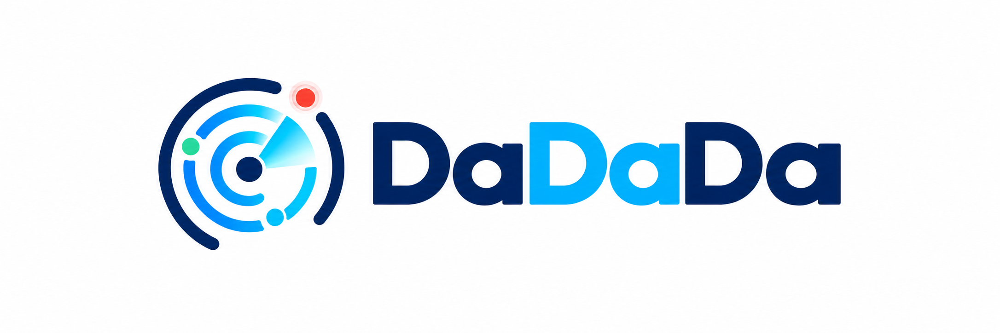

<p align="center">
  
</p>

# DaDaDa

What's breaking now?

Developer が使っている Cloud / SaaS / Runtime / OSS の **現在状態・発生中の障害・Security Advisory** を 1 画面で確認する Developer Status / Security Radar。
自分で監視はせず、公開 Status Page / Security Feed を **Collect → Normalize → Browse** する。

## 主な機能

- ホーム (`/`) は発生中の障害を先頭に表示し、セキュリティ・公式告知・悪用確認済み情報をタブで切り替えられます。サービスの稼働状況は右側に並び、小さい画面では縦に並びます。ページ全体をスクロールする構成です。
- 情報一覧は最初の4件を表示し、「さらに表示」で12件ずつ追加できます。タブの件数と一覧の件数は同じ絞り込み条件で集計します。公式告知には各サービスの最新1件と、深刻度の記載がないセキュリティ告知を表示します。
- サービス名から詳細画面 (`/d/:providerId`) に移動し、現在状態・発生中の障害・最近の履歴・公式告知・セキュリティ情報を確認できます。
- セキュリティ情報は言語と重要度で絞り込めます。重要度のない公式告知と、CISA KEV（悪用が確認された脆弱性）はそれぞれ別枠で表示します。
- ホームと詳細画面は60秒ごとにAPIを再取得します。上流からの収集はStatusが5分ごと、Securityが30分ごとです。取得済みの稼働状態が30分を超えて古くなると「不明」にします（RSSなどの「未判定」は維持します）。
- 日本語・英語の切り替えと、OSの設定に合わせたライト・ダーク表示に対応しています。

## Stack

- Cloudflare Workers + Hono (API / Cron)
- Cloudflare D1
- React + Vite (`@cloudflare/vite-plugin` で Worker と SPA を 1 プロジェクトに)
- Vanilla CSS

## クイックスタート

Node.js 22 と pnpm 12.14.0 が必要です。

```bash
pnpm install
cp wrangler.sample.jsonc wrangler.jsonc # 環境固有の設定を手元に作成
cp .dev.vars.example .dev.vars       # ADMIN_TOKEN などを設定
pnpm run db:migrate:local             # ローカル D1 に migration
pnpm run dev                          # http://localhost:5173
```

初回は DB が空のため、手動収集が必要です。手順・テスト・コミット前のチェックは [docs/development.md](docs/development.md) を参照してください。

## MCP / Agent 連携

Streamable HTTP の MCP サーバーを `/api/mcp` で提供します。認証なしで接続でき、公開データのみを返す読み取り専用です。MCP 対応クライアントに次の URL を Remote MCP サーバーとして登録してください。

```text
https://<公開ドメイン>/api/mcp
```

ツール一覧、接続設定、利用上の注意は [docs/mcp.md](docs/mcp.md) を参照してください。

## ドキュメント

詳細は [docs/](docs/README.md) にまとめています。

| 知りたいこと | ドキュメント |
| --- | --- |
| MCP の接続方法・ツール | [docs/mcp.md](docs/mcp.md) |
| HTTP API | [docs/api.md](docs/api.md) |
| デプロイ・Cron | [docs/deployment.md](docs/deployment.md) |
| 収集している Source | [docs/sources.md](docs/sources.md) |
| サービスごとの状態・告知の扱い | [docs/status-handling.md](docs/status-handling.md) |
| セキュリティ情報の収集範囲 | [docs/security-alerts.md](docs/security-alerts.md) |
| ローカル開発・テスト・E2E | [docs/development.md](docs/development.md) |
| 依存関係の安全性 | [docs/dependency-safety.md](docs/dependency-safety.md) |
| 構成・Source の追加・実装方針 | [docs/architecture.md](docs/architecture.md) |
| 初期の MVP 設計書 | [docs/dadada-mvp-design.md](docs/dadada-mvp-design.md) |

## 表示言語

日本語を初期表示とし、ヘッダーの言語選択から English に切り替えられます。選択はブラウザーに保存されます。公式記事のタイトル・本文とサービス名は原文のまま表示します。

## ライセンス

DaDaDa の独自ソースコードは **GNU Affero General Public License v3.0（AGPL-3.0-only）** で提供します。正式な条件は [LICENSE](LICENSE) を参照してください。改変版を配布したり、Web サービスとして提供したりする場合は、その版のソースコードを利用者が入手できるようにする必要があります。詳しい解説は [docs/license.md](docs/license.md) を参照してください。
